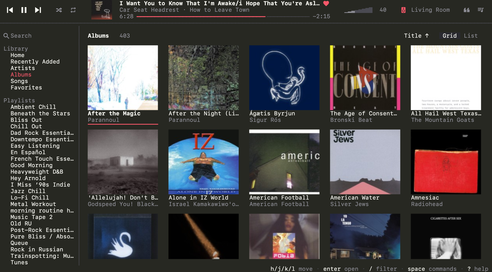
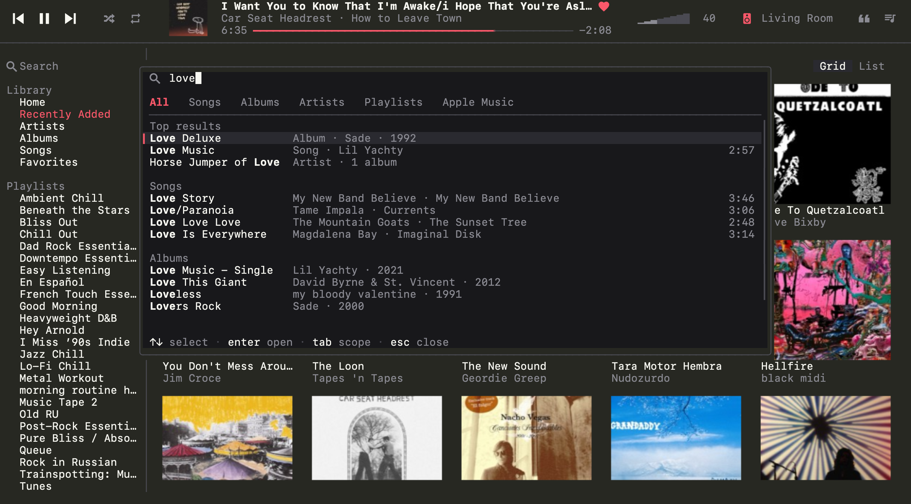
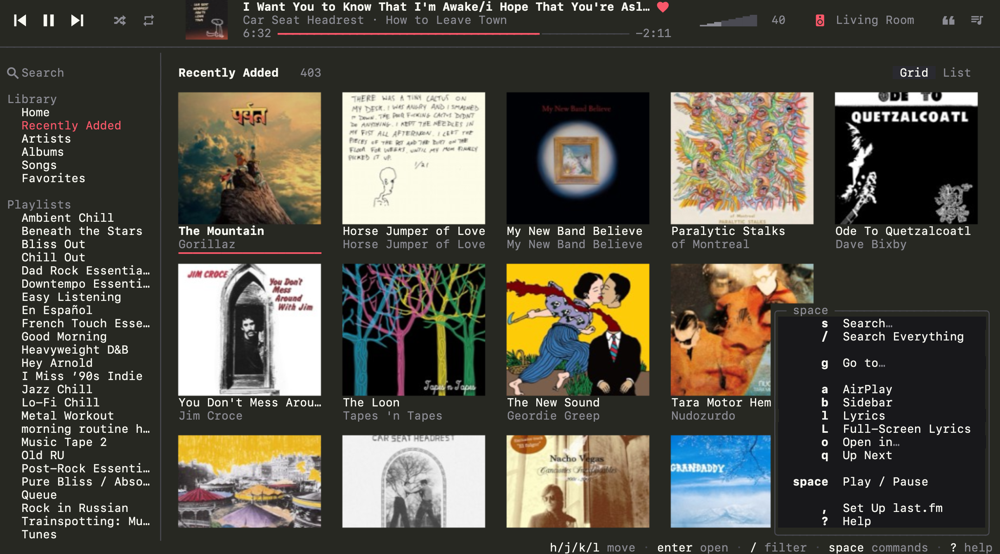
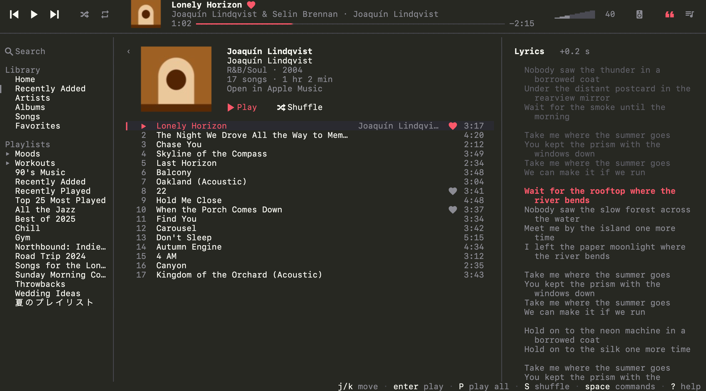

<div align="center">

<picture>
  <source media="(prefers-color-scheme: dark)" srcset="docs/logo/encore-dark.svg">
  
</picture>

A fast terminal client for Apple Music on macOS.

[](LICENSE)
[](#install)
[](go.mod)
[](#homebrew)



</div>

Music.app still plays the audio, handles AirPlay and syncs your library. encore replaces its window with a keyboard and mouse UI that keeps your library in memory, so every list opens at once and search answers in a few milliseconds.

## Features

- **Vim-style keys.** `j` `k` `gg` `G`, counts like `5j`, and `space` as a leader key with a popup that lists what can follow. Every binding can be remapped.
- **Full mouse support.** Click, double-click, right-click menus, the scroll wheel, seeking on the progress bar, dragging the volume and pane borders.
- **Fast library search.** All of your songs, albums, artists and playlists, searched in memory as you type.
- **Synced lyrics.** Apple Music's own lyrics, with each word filling in as it is sung, and [LRCLIB](https://lrclib.net) for everything else. Click a line to jump to it.
- **Home.** Apple Music's Home page with your stations, mixes, live radio and new releases.
- **Apple Music catalog.** Search the whole catalog and stream songs, albums and artists you don't have in your library.
- **AirPlay.** Pick one or several output devices, each with its own volume. When macOS quietly drops the HomePod after sleep, encore reconnects it.
- **last.fm scrobbling.** Plays are written to disk first, so nothing is lost offline.
- **Album art.** iTerm2 images in WezTerm and iTerm2, kitty graphics in kitty and Ghostty, sixel if you ask for it, also inside tmux. Half blocks in every other terminal.
- **Open in Music.app.** `M` opens the selected Apple Music song, album or playlist in Music, to add it to your library or see more.
- **Demo mode.** `encore --demo` runs against a generated library and never touches Music.

<table>
  <tr>
    <td width="50%"></td>
    <td width="50%"></td>
  </tr>
  <tr>
    <td align="center">Search everything with <code>space /</code></td>
    <td align="center">Press <code>space</code> to see what comes next</td>
  </tr>
  <tr>
    <td colspan="2"></td>
  </tr>
  <tr>
    <td colspan="2" align="center">An album page with synced lyrics</td>
  </tr>
</table>

The lyrics screenshot uses the built-in demo library (`encore --demo`), so its names, cover and lyrics are made up.

## Install

encore needs macOS 14 or later and Music.app. The release runs on Apple silicon and Intel. I test it on macOS 27 with Music 1.7 on Apple silicon; Intel and older macOS versions should work but get less testing.

### Homebrew

```sh
brew install bogdankim/tap/encore
```

### From source

Building takes Go 1.26 or later and Xcode or the Swift toolchain (Swift 6).

```sh
git clone https://github.com/bogdankim/encore.git
cd encore
make install
```

`make install` builds the Swift helper, embeds it in the Go binary and copies the result to `~/.local/bin/encore`. Make sure that folder is on your `PATH`.

## First run

Run `encore`. macOS asks two questions about encore, in whichever terminal you use:

1. Whether encore may control Music. Click Allow.
2. Whether encore may access Apple Music and your media library. Click Allow.

If you clicked Don't Allow, the footer says so. Turn encore back on in System Settings → Privacy & Security → Automation, or → Media & Apple Music, then restart encore. Without media library access encore still works, but it reads the library from Music, which is slower.

To look around without touching Music, run `encore --demo`. `encore --version` prints the version.

More on how permissions work, and why an update can ask again, is in [docs/usage.md](docs/usage.md#first-run-and-permissions).

## Usage

The player bar is on top, the sidebar with your library and playlists on the left, the current page in the middle, and an optional lyrics or Up Next pane on the right. Press `?` for every binding, `:` for the command palette, or `space` and read the popup.

| Keys | Action |
|---|---|
| `j` `k` / `h` `l` | move / switch pane |
| `enter` | play the song, or open the album, artist or playlist |
| `esc` | close, or go back |
| `p` or `space space` | play / pause |
| `]` / `[` | next / previous track |
| `.` / `,` | seek 10 s forward / back |
| `=` / `-` | volume up / down |
| `P` / `S` | play / shuffle the whole page |
| `a` / `A` | add to Up Next / play next |
| `f` | favorite |
| `/` | filter the current list |
| `space /` | search everything |
| `space s m` | search Apple Music |
| `space g h` | go to Home |
| `space l` / `space L` | lyrics pane / full-screen lyrics |
| `space q` | Up Next |
| `space a` | AirPlay devices |
| `space ,` | set up last.fm |
| `M` | open in Music.app |
| `q` | quit; Music keeps playing |

The full key list and a guide to each feature (Home, the Apple Music catalog, lyrics, AirPlay, last.fm, tmux) are in [docs/usage.md](docs/usage.md).

## Configuration

encore reads `~/.config/encore/config.toml` (or `$XDG_CONFIG_HOME/encore/config.toml`). The file is optional and encore never writes it. A few examples:

```toml
theme = "encore"   # follows the terminal's light or dark background
accent = "#FA586A"
art = "auto"       # "iip", "kitty", "sixel", "blocks" or "off"
start = "recent"   # the page encore opens on, e.g. "home" or "albums"

[lyrics]
lrclib = false     # Apple's lyrics and Music's own only

[keys]
"player.next" = ["n"]
```

Every option with its default is in [docs/usage.md](docs/usage.md#configuration).

## How it works

encore is a Go program built on [Bubble Tea](https://github.com/charmbracelet/bubbletea). It never plays audio itself. Everything that needs a macOS API lives in `encore-bridge`, a small Swift helper that encore starts and talks to with one JSON object per line over stdin and stdout. The helper:

- sends Apple Events straight to Music, about 8 ms each, where `osascript` takes 200 ms;
- reads your library in one snapshot through iTunesLibrary.framework, which encore keeps in memory and caches on disk;
- plays Apple Music catalog songs and stations through MediaRemote;
- reports Music's play state changes as events.

Music has no Up Next that other apps can script, so encore keeps its own queue and plays it through one ordinary playlist named `encore`. The design, the bridge protocol and the measurements behind them are in [docs/design.md](docs/design.md) and [docs/research](docs/research/README.md).

## Private APIs

encore relies on private, undocumented parts of macOS. Apple doesn't support them for other apps and can change or remove any of them in any macOS or Music update. When that happens, the feature that depends on it stops working until encore catches up, and some breaks may not be fixable.

What encore uses:

- **MediaRemote.framework.** Plays Apple Music catalog songs and radio stations through Music, and resends pause or play when Music ignores an Apple Event.
- **TCC.framework.** Checks and requests Media & Apple Music access for the helper.
- **`responsibility_spawnattrs_setdisclaim`.** Starts the helper as its own process, so macOS asks about encore instead of your terminal.
- **Private iTunesLibrary properties.** `cloudType` and `globalID`, to spot cloud tracks that no longer play and to tell Apple's playlists from yours.
- **Music's own cache.** Apple's synced lyrics and the Home page come from `~/Library/Caches/com.apple.Music`, read-only. encore reads only those responses. It never reads the sign-in headers or tokens stored next to them. The format is undocumented and can change with any Music update.

The Apple Music search uses the public iTunes Search API, which allows about 20 requests a minute.

## Maintenance

encore is a side project, and I maintain it by myself, to the best of my ability. There's no warranty and no schedule. When a macOS or Music update breaks something I'll try to fix it, but I can't promise when, or that a fix is possible.

Issues and pull requests are welcome. A bug report helps most when it includes your macOS and Music versions, your terminal, and the steps that lead to the problem.

## Building and testing

```sh
make build   # Swift helper + Go binary in bin/encore
make test    # go test ./... and the helper's swift test
make demo    # build, then run against the demo library
make run     # build, then run against Music
make dist VERSION=0.1.0   # release tarball in dist/, prints its sha256
```

`ENCORE_BRIDGE=/path/to/encore-bridge` makes encore use that helper instead of the embedded one. `ENCORE_INHERIT_TCC=1` makes the helper use your terminal's permissions, which saves a prompt after each rebuild.

`tools/snap` runs encore in a pseudo-terminal rendered by xterm.js in headless Chrome, plays a script of keys and mouse events, and saves PNG and text screenshots. Setup and the script format are in [tools/snap/README.md](tools/snap/README.md).

```sh
cd tools/snap && npm ci && cd -
node tools/snap/snap.mjs --cols 140 --rows 42 \
  --script tools/snap/scripts/albums-recent.json -- ./bin/encore --demo
```

## License

[MIT](LICENSE) © 2026 Bogdan Kim

encore is not affiliated with, endorsed by or sponsored by Apple. Apple Music, Music, AirPlay and macOS are trademarks of Apple Inc.

<br>

<picture>
  <source media="(prefers-color-scheme: dark)" srcset="docs/logo/encore-cut-dark.svg">
  
</picture>
